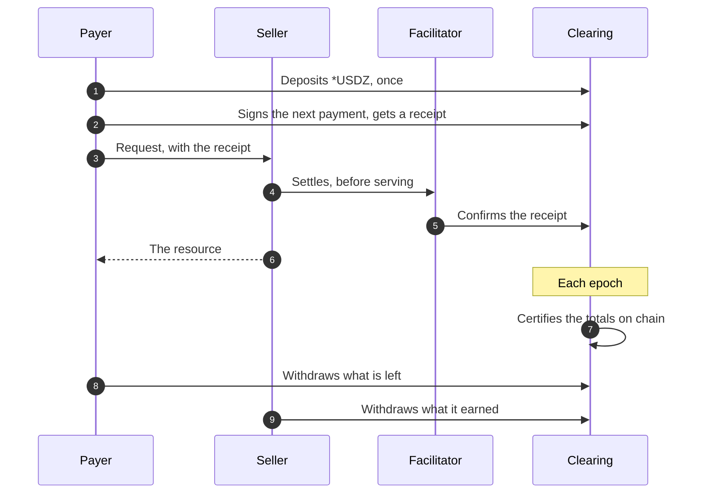

> ## Documentation Index
> Fetch the complete documentation index at: https://docs.metalntwx.com/llms.txt
> Use this file to discover all available pages before exploring further.

# Offer Pay-per-Call Clearing

> Charge per request below a transaction's cost: the payer deposits once and signs each payment off chain, and one deposit pays any seller that offers clearing

Clearing lets you charge per request at prices far below a transaction's
cost. The payer deposits `*USDZ` once, under a clearing key of its own, and
signs a running total with each request. One deposit pays any seller that
offers clearing. Metal's clearing service answers each payment with a signed
receipt and certifies the totals on chain each epoch, a batch of a few
seconds of payments. An epoch is final once its challenge window, five
minutes, has passed. Either side then queues a withdrawal of what is its own
and claims it once a later epoch carrying it is final, 20 minutes or more
after the payment.

Clearing is its own x402 scheme, `bajillion`, settled through the same
[facilitator](https://docs.metalntwx.com/agents/facilitator.md) as `exact`. A seller can offer both. A
payer set up for clearing pays by clearing wherever the offer is for its
wallet's deployment and within its `maxAmount`, and refuses any other
request on its network unless set up to pay it by `exact`.



## Clearing wallets

Clearing pays from and to a clearing account: a key of its own, held by
payer and seller alike, separate from any Metal account.
`openClearingWallet(directory)` from `@metalntwx/metal-pay/node` creates
one the first time and opens it after that. Its public key,
`wallet.signer.publicKey`, is the seller's `payTo` and the account a payer
deposits under. The directory holds the key and the payer's record of its
payments: keep it, and open it from one process at a time. A wallet's record
is for one Clearing deployment: if the deployment is replaced, open a new
wallet, and take the old account's funds out with the old wallet, by
`withdrawFromClearing`, or `recoverFromClearing` once the deployment has
faulted. It needs Node 22.13 or later (23.4 or later on Node 23), for
`node:sqlite`.

## 1. Offer clearing

On the server from the [Seller Quickstart](https://docs.metalntwx.com/agents/quickstart-accept.md),
register the clearing scheme beside `exact` and list both:

```typescript theme={null}
import { HTTPFacilitatorClient, x402ResourceServer } from "@x402/core/server";
import { ClearingServerScheme, METAL_NETWORKS, registerMetalScheme } from "@metalntwx/metal-pay";
import { openClearingWallet } from "@metalntwx/metal-pay/node";

const wallet = await openClearingWallet("./clearing-wallet");
const facilitator = new HTTPFacilitatorClient({ url: METAL_NETWORKS.testnet.facilitatorUrl });
const server = registerMetalScheme(new x402ResourceServer(facilitator), { networks: ["testnet"] })
  .register("eip155:63825", new ClearingServerScheme("eip155:63825"));

// in the route table
accepts: [
  { scheme: "bajillion", network: "eip155:63825", payTo: wallet.signer.publicKey, price: "0.001" },
  { scheme: "exact", network: "eip155:63825", payTo: "<your Metal address>", price: "0.01" },
],
```

Prices are dollars in `*USDZ`. The offer names the Clearing contract and the
clearing service your facilitator settles against, which its `/supported`
lists in the `bajillion` entry's `extra`. If it lists none in `*USDZ` on the
network, building the offer fails. The payer's client refuses an offer for
any contract but the one it is set up with. Each payment is bound to the
URL asked for, so a payment made for one URL buys nothing at another.

## 2. Deposit

The payer deposits from a funded key into the Clearing contract, under its
clearing key. The facilitator's `/supported` names the contract,
`extra.settlement`, the clearing service, `extra.serviceUrl`, and its
validators, `extra.validatorUrls`: keep all three with the wallet, since
recovery needs them if the facilitator is gone.

```bash theme={null}
npm install @metalntwx/metal-pay@0.3.4 viem
```

```typescript theme={null}
import { privateKeyToAccount } from "viem/accounts";
import { depositToClearing, USDZ, usdzBaseUnits } from "@metalntwx/metal-pay";
import { openClearingWallet } from "@metalntwx/metal-pay/node";

const account = privateKeyToAccount(process.env.AGENT_PRIVATE_KEY as `0x${string}`);
const wallet = await openClearingWallet("./payer-wallet");
await depositToClearing({
  rpcUrl: process.env.METAL_RPC_URL!,
  chainId: 63825,
  from: account,
  settlement: "<Clearing contract>",
  asset: USDZ.address,
  account: wallet.signer.publicKey,
  amount: BigInt(usdzBaseUnits("0.05")),
});
```

`from` sends an approval unless its allowance already covers the amount,
then the deposit, and pays the gas of both. The contract takes deposits
between epochs, so the call waits for that window first. Amounts
are the token's base units, and a deposit is a whole number of millionths of
a token, `0.000001` `*USDZ`: Clearing counts in those units. A Clearing
contract holds at most 2^64 - 1 of them in all, about 1.8e13 `*USDZ`, one pool
shared by every account on the network. The call refuses at once a deposit
that would take it past that, and a contract that holds another token. Room
comes back as withdrawals' payouts are claimed.

## 3. Pay

In the same file as step 2, with its imports, `account` and `wallet`:

```typescript theme={null}
import { createClearingClient, createMetalPaymentClient, registerClearingClient } from "@metalntwx/metal-pay";

const { client, fetchWithPayment } = createMetalPaymentClient({ account, network: "testnet" });
const clearing = createClearingClient({
  serviceUrl: "<clearing service>",
  rpcUrl: process.env.METAL_RPC_URL!,
  network: "eip155:63825",
  settlement: "<Clearing contract>",
  asset: USDZ.address,
  signer: wallet.signer,
  store: wallet.store,
  maxAmount: BigInt(usdzBaseUnits("0.01")),
});
registerClearingClient(client, "eip155:63825", clearing);
```

The wallet's `maxAmount` is the most one clearing payment may cost. A
request on the wallet's network with no clearing offer it can pay, for
another deployment or above that `maxAmount`, fails, pays nothing and names
which: raise `maxAmount` or pay another seller. Pass
`{ exactFallback: true }` as `registerClearingClient`'s fourth argument to
pay such a request by `exact` instead, an on-chain transfer from `account`
outside the deposit. `createMetalPaymentClient`'s own `maxAmount`, 1
`*USDZ` by default, caps those and every other payment but a clearing one.

A payment is made when the service issues its receipt, so a request that
fails after that still cost its price. One clearing account pays one
request at a time, about one every three seconds, so jobs that pay in
parallel each take a wallet and a deposit. Each deposit waits for the
gap between epochs, so deposit every job's share before starting any job. A
fresh deposit pays from the next epoch.

If the service's answer to a payment is lost, the account holds that
payment and pays nothing else until it goes through or is refused. Send the same request
again, to the same URL at the same price: the held payment is sent again,
so it never pays twice. If that URL no longer offers clearing at that
price, send the held payment with
`clearing.pay((await clearing.pendingInvoice())!)`. A held payment is
settled from the service's receipt when the service kept one, and released
when it has none and the epoch it was signed for has closed, the service is
past it, or the chain registered it under another anchor. A payment the
service does not take fails with a [refusal](#refusals) that says what to do.

`(await wallet.store.load())?.payments` is the wallet's record of the
payments the service took, by invoice id, each with `invoice.amount` in the
token's base units and `invoice.recipient`, the seller's clearing key.

`clearingSpendable({ rpcUrl, settlement, serviceUrl, account: wallet.signer.publicKey })`
is the service's estimate of what the account can still spend, in the
token's base units. It counts a deposit from the epoch after it lands, and
around an epoch's close it can read low, even below zero. Nothing shows a
deposit not yet counted, so budget from your own ledger of deposits and
payments, and use the estimate only to tell whether a payment can go now.

## 4. Withdraw

A payer continues the same file. A seller uses the `wallet` from step 1,
with a funded viem account of its own as `account`:

```typescript theme={null}
import { withdrawFromClearing } from "@metalntwx/metal-pay";

const result = await withdrawFromClearing({
  rpcUrl: process.env.METAL_RPC_URL!,
  chainId: 63825,
  from: account,
  settlement: "<Clearing contract>",
  serviceUrl: "<clearing service>",
  signer: wallet.signer,
});
```

A payer's unused deposit and a seller's earnings leave the same way. Only a
finalized balance can leave: payments from the open epoch wait for it to
finalize. The first call queues a withdrawal of the finalized balance, paid
to `from` or to a `destination` given, and answers `sent` with its
transaction under `queued` and an empty `claimed`. With no payout to claim
and no finalized balance, it answers `empty`. That includes a balance whose
last payments are not yet final: call again after the challenge window that
follows the account's last payment or deposit.

Until the epoch carrying the withdrawal finalizes, a call answers
`waiting` with that epoch. Once it has finalized, the next call claims the
payout to the destination the withdrawal named, answers `sent` with the
amounts and transactions under `claimed`, and queues any balance finalized
since. A payout the destination refuses is `deferred`: it waits in the
contract until that address calls `withdrawUnclaimed`. `from` pays the gas
of each transaction.

`clearingBalance(serviceUrl, wallet.signer.publicKey)` returns the account's
balance as of its last final epoch, `{ amount, state, opening }`: `amount`
in Clearing's millionths of a `*USDZ`, and `opening` the proof a withdrawal
closes it with, or `null` when the service retains none. A loop that
withdraws everything stops at an `empty` once `amount` is `"0"` and no
payment or deposit of the account is newer than a challenge window.

A withdrawal or claim refused or reverted because an epoch finalized as it
was sent moves nothing but the gas: call again after the next epoch. If the
clearing service cannot be reached, the error says so; once it has
stopped, pass one of the `extra.validatorUrls` kept from step 2 as
`serviceUrl`. A validator proves a payout or a balance only for an epoch it
retained, so try each until one has. Once the service has missed a
deadline, the call fails with an error that names `recoverFromClearing`.

## When a payment is final

When an epoch closes, the clearing service and its validators certify its
totals on chain. For the epoch's challenge window, anyone holding a receipt
the totals contradict can prove it on chain, which halts the deployment.
After the window the epoch is final: its receipts are final, and the
withdrawals it carries can be claimed. The Clearing contract's `policy()`
gives a deployment's windows in seconds: the admission delay, the shortest
and longest challenge window, the deposit timeout, and the shortest and
longest withdrawal notice.

To show the epoch clock, read the contract with the exported `clearingAbi`.
Epochs are numbered from 0. `admittedCount` is how many the contract has
admitted, so the open epoch, or the next to open, is number
`admittedCount`, and epoch N is final once `finalizedCount` is above N. The
epoch in `withdrawFromClearing`'s `waiting` is claimable once it is final.

If the service stops, the contract has a way out. Once the service misses
a deadline, to admit an epoch, a deposit or a queued withdrawal, anyone
can fault the deployment and start recovery. Each account then takes its
last finalized balance, and a deposit no final epoch counted is refunded.
`recoverFromClearing` takes the same options as `withdrawFromClearing`,
with the service or any of its validators as `serviceUrl`, or a list of
them, and does each step that is due: pass the service and the
`extra.validatorUrls` from step 2. Each proof comes from the first in the
list that has retained its epoch. It answers `operating` while the service
keeps the deadlines that hold the account's funds, `waiting` while an epoch
admitted before the fault is in its challenge window, and `recovered` with
what it took. Once the deployment has faulted, a withdrawal whose epoch is
already final is claimed at once, and `waiting` lists it under `claimed`.
When no service gives a proof, the error names it and what was sent, and a
later call takes the rest.

A service usually stops with an epoch registered: recovery can then start
about five minutes after the stop, and finishes about five minutes after
that. If it stopped between epochs, a finalized balance with no withdrawal
queued, or a final withdrawal not yet claimed, holds no deadline, so
`recoverFromClearing` answers `operating` for them. Call
`withdrawFromClearing` with a validator as `serviceUrl`, as in
[step 4](#4-withdraw), to claim the final withdrawal and queue one of the
balance; recovery can start once that one's deadline passes, the
deployment's maximum withdrawal notice later, 7 days.

## Refusals

A clearing payment the service does not take fails the request, and
`fetchWithPayment` throws an error whose `cause` is a `ClearingRefusal`.
Its `reason` says why, `retry` what to do, and its message both:

| Reason | `retry` | Meaning |
| - | - | - |
| `between_epochs` | `retry_after_ms` | The service takes no payments from an epoch's close until the next epoch is registered, a gap of a few seconds every epoch. Nothing was paid: send the request again after `retry.ms`, and again after each further `between_epochs`. If it lasts longer than an epoch, check that `serviceUrl` is the facilitator's `extra.serviceUrl` (a validator takes no payments), or the service is down. |
| `insufficient_deposit` | `deposit` | The service refused the payment, and its estimate of what the account can spend is below the price. Nothing was paid: deposit more, then send the request again. |
| `answer_lost` | `repeat_same_request` | No receipt the wallet could check came back, so the payment's outcome is unknown and the account holds it: send the request to the same URL at the same price, `retry.url` at `retry.amount`, again after `retry.ms`. If the service answered with an acknowledgment that does not verify, `serviceUrl` may be another deployment's: check it against the facilitator's `/supported` first. If it is still held after an epoch, check `serviceUrl` as for `between_epochs`. |
| `payment_held` | `repeat_same_request` | The account holds an earlier payment, for `retry.url` at `retry.amount`. Nothing was paid for this request: send that one again after `retry.ms` first, or send it with `pendingInvoice()` as in [step 3](#3-pay). |

Once the deployment has faulted, a payment fails with an error that names
`recoverFromClearing`, and so does sending a held payment again. A
payment the service refuses for any other reason fails with an error that
says to send the request again.

The facilitator refuses a clearing payment presented to a seller with one
of these reasons:

| Reason | Meaning |
| - | - |
| `invalid_clearing_payment` | The payment, its receipt or its invoice does not check out, or the contract or the service could not be reached. |
| `already_settled` | This receipt settled before. The facilitator records a receipt before the seller's handler runs, so a receipt presented again, or twice at once, is served at most once; if the handler then fails, the seller owes the payer the delivery. |
| `payment_already_used` | This receipt settled for another seller or under another reference. |

A settled clearing payment's `transaction` is empty, since nothing is sent
on chain for it; `extra.clearing` carries the receipt, the invoice and
`status: "preconfirmed"`: the receipt is the service's acknowledgement,
final once [its epoch is](#when-a-payment-is-final).
`GET /settlements?payTo=<clearing key>` lists them with `scheme` `bajillion`
and an empty `transaction`: match a payment by its `id`, the
`extra.settlement.id` of its settle answer.

> **[Seller Quickstart](https://docs.metalntwx.com/agents/quickstart-accept.md)**
>
> The seller this page adds clearing to.

> **[Facilitator](https://docs.metalntwx.com/agents/facilitator.md)**
>
> Endpoints, limits, refusal reasons and retries.


This documentation is built and hosted on [Mintlify](https://mintlify.com), a developer documentation platform.